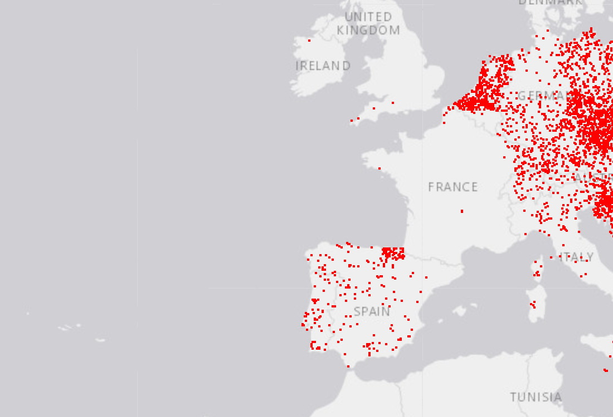

# Li Yuechi - Data Science Portfolio

## About Me

Hello, my name is Li Yuechi. I am a student interested in data science, data analysis, and data visualization.

This portfolio presents my data science learning project and demonstrates how I use Python to clean, analyze, and visualize data.

## Technical Skills

- Python
- pandas
- NumPy
- Matplotlib
- Seaborn
- geoplotlib
- Jupyter Notebook
- Data cleaning
- Exploratory data analysis
- Data visualization
- GitHub

## Featured Project

### Analysis and Visualization of European City Density

#### Research Question

How are cities distributed across Europe, and what geographic patterns can be identified through data visualization?

#### Project Description

This project analyzes a city dataset containing country codes, city names, population values, latitude, and longitude. The data was filtered to include European cities. Dot-density and Voronoi visualizations were created to study the geographic distribution of cities.

An interactive custom layer was also created. Users can press the left and right arrow keys to display cities beginning with different letters.

#### Project Visualization

The visualization shows that city records are concentrated in Central Europe, Western Europe, and parts of Southern Europe. This indicates that the distribution of cities is not uniform across Europe.

#### Project Repository

[View the complete project repository](https://github.com/mc640935/data-science-project)

#### Project Status

Completed.

## What I Learned

This project helped me practice data loading, data cleaning, filtering, geographic visualization, and interactive custom layers. I also learned how GitHub repositories and GitHub Pages can be used to present data science work publicly.

## Contact

GitHub: https://github.com/mc640935
